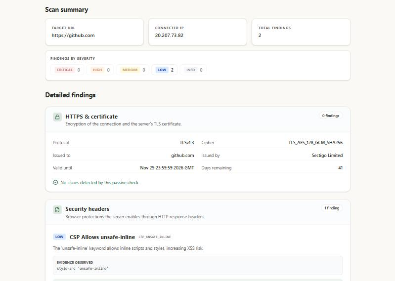
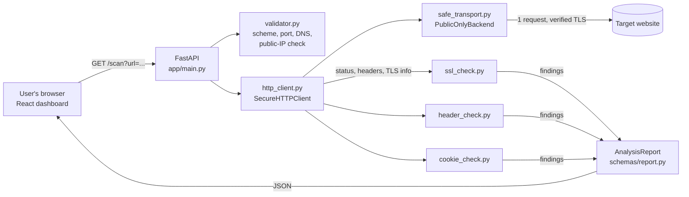

# Sentinel Zero

**A passive website security analyzer.** Enter a website address and Sentinel
Zero produces a structured report on its HTTPS certificate, HTTP security
headers and cookie security attributes. Every finding includes a severity, the
evidence observed, an explanation and remediation steps.

Sentinel Zero is **passive**: it makes one ordinary request, the same as a
browser visiting the home page. It never attacks, guesses passwords or sends
exploit payloads.

> B.Tech cybersecurity project by Lakshay Khatri.



---

## Contents

1. [Problem statement](#problem-statement)
2. [Objectives](#objectives)
3. [Features](#features)
4. [Architecture and data flow](#architecture-and-data-flow)
5. [Technology stack](#technology-stack)
6. [Folder structure](#folder-structure)
7. [Installation (Windows)](#installation-windows)
8. [Running the application](#running-the-application)
9. [Testing](#testing)
10. [API reference](#api-reference)
11. [Security design](#security-design)
12. [Limitations](#limitations)
13. [Deployment](#deployment)
14. [Future improvements](#future-improvements)
15. [Ethical use](#ethical-use)

---

## Problem statement

Many websites are deployed without basic browser-side protections: no
Content-Security-Policy, no HSTS, cookies without `Secure` or `HttpOnly`, or
certificates about to expire. These settings are cheap to fix but easy to
overlook. Checking them by hand means reading raw HTTP headers and knowing what
each one should look like.

A tool that does this automatically is also a security risk in its own right.
A server that fetches any URL a user types can be abused to reach **internal**
systems it should never talk to: databases, admin panels, or the cloud metadata
service that holds server credentials. This is called **Server-Side Request
Forgery (SSRF)**. A safe scanner must check public websites without becoming a
doorway into private networks.

## Objectives

1. Check a website's HTTPS certificate, security headers and cookies, and
   report the results clearly.
2. Base every finding on observed evidence, with a consistent, documented
   severity, an explanation and remediation advice.
3. Stay passive and non-destructive.
4. Prevent the scanner itself from being used for SSRF, including DNS
   rebinding attacks.
5. Present results in a clear, accessible dashboard that is honest about what
   a passive scan cannot prove.
6. Back the implementation with automated tests.

## Features

**Analysis**
- **HTTPS & certificate:** detects plain HTTP and HTTP-to-HTTPS redirects,
  certificates that fail verification (expired, self-signed, wrong host),
  certificates expiring within 30 days, and reports the negotiated TLS version,
  cipher, subject, issuer and expiry.
- **Security headers:** checks Content-Security-Policy, Strict-Transport-Security,
  X-Content-Type-Options, X-Frame-Options and Referrer-Policy. It tells apart
  headers that are *missing*, *empty* or *present but weak*, e.g. HSTS
  `max-age=0`, CSP `'unsafe-eval'` or `Referrer-Policy: unsafe-url`.
- **Cookies:** checks every `Set-Cookie` header for `Secure`, `HttpOnly`,
  `SameSite` and `__Host-` / `__Secure-` prefix rules. **Cookie values are never
  shown**, because they may be secrets.
- **31 finding types** with stable IDs and documented severities. See
  [docs/SEVERITY.md](docs/SEVERITY.md).

**Safety**
- Connection-time SSRF protection that resists DNS rebinding.
- Only public IP addresses and standard web ports (80, 443, 8080, 8443).
- Redirects are not followed; proxy environment variables are ignored.
- The response body is never downloaded, which removes any "gzip bomb" risk.
- Timeouts, per-IP rate limiting and a concurrent-scan limit.

**Dashboard**
- Summary with the connected IP and finding counts by severity.
- Findings grouped by area, sorted by severity, each with evidence and a fix.
- Clear loading, error, empty and "not checked" states.
- Works on phones; colours meet WCAG AA contrast.

## Architecture and data flow



**Step by step**

1. The user enters a URL. The frontend does friendly checks (e.g. adds
   `https://` if missing) and calls `GET /scan?url=...`.
2. `main.py` applies the rate limit, the concurrency limit and a 15-second
   overall timeout.
3. `validator.py` checks the scheme, port and credentials, resolves the
   hostname, and rejects it if **any** address is non-public.
4. `SecureHTTPClient` sends one GET request. Every TCP connection goes through
   `PublicOnlyBackend`, which resolves the hostname **again at connection
   time**, checks every address, and connects to the exact IP it checked.
   TLS certificate verification stays on.
5. The client keeps the status code, headers and TLS details, but not the
   body. A certificate that fails verification becomes a finding instead of
   an error.
6. The three analyzers turn this evidence into findings, which `main.py`
   returns as an `AnalysisReport`.
7. The dashboard displays the report exactly as received.

## Technology stack

| Layer | Technology |
|---|---|
| Frontend | React 19, TypeScript, Vite, Tailwind CSS v4, Axios, lucide-react icons |
| Backend | Python 3, FastAPI, Pydantic v2, Uvicorn |
| HTTP | httpx / httpcore with a custom network backend, anyio |
| Testing | pytest; oxlint for the frontend |

Tested with Python 3.14.5, Node.js 24.21 and npm 11.19 on Windows 11.

## Folder structure

```text
sentinel-zero/
├── README.md
├── docs/
│   ├── SEVERITY.md              # every finding ID, its severity and why
│   ├── TESTING.md               # how the project is tested + recorded results
│   ├── VIVA.md                  # presentation and viva preparation guide
│   ├── DEPLOYMENT.md            # step-by-step Vercel deployment and checks
│   └── screenshots/
└── backend/
    ├── requirements.txt         # runtime packages
    ├── requirements-dev.txt     # + test tools
    ├── vercel.json              # Vercel function settings
    ├── .python-version
    ├── pytest.ini
    ├── app/
    │   ├── main.py              # FastAPI app: /health, /scan, limits, errors
    │   ├── core/
    │   │   ├── validator.py     # URL, port and public-IP validation
    │   │   ├── http_client.py   # SecureHTTPClient: one safe request
    │   │   └── safe_transport.py# connection-time SSRF protection
    │   ├── analyzers/
    │   │   ├── ssl_check.py     # HTTPS and certificate findings
    │   │   ├── header_check.py  # security header findings
    │   │   └── cookie_check.py  # cookie attribute findings
    │   └── schemas/
    │       └── report.py        # Severity, Finding, AnalysisReport
    ├── tests/                   # 140 offline tests + 7 opt-in live tests
    └── frontend/                # React + Vite dashboard
        ├── .env.example
        ├── vercel.json          # security headers for the deployed site
        └── src/
            ├── pages/DashboardPage.tsx
            ├── components/      # Navbar, Footer, report/* cards and sections
            ├── services/api.ts  # backend calls and error messages
            ├── utils/           # URL checks, finding grouping and sorting
            └── types/index.ts   # TypeScript types matching the API
```

## Installation (Windows)

**Prerequisites**
- [Python](https://www.python.org/downloads/) 3.10 or newer (the minimum the
  dependencies require). Only Python 3.14 has been tested.
- [Node.js](https://nodejs.org/) 20.19+ or 22.12+ with npm (the minimum Vite 8
  requires). Only Node.js 24 has been tested.
- Git

**1. Get the code** (PowerShell, in any folder):

```powershell
git clone https://github.com/Lakshay-Khatri/sentinel-zero.git
cd sentinel-zero
```

**2. Backend setup.** A virtual environment keeps the project's packages separate:

```powershell
cd backend
python -m venv .venv
.\.venv\Scripts\Activate.ps1
python -m pip install -r requirements-dev.txt
```

(`requirements-dev.txt` installs the app's packages plus the test tools.)

If PowerShell says running scripts is disabled, run
`Set-ExecutionPolicy -Scope CurrentUser RemoteSigned` once, then activate
again.

**3. Frontend setup** (a second PowerShell window, from the `sentinel-zero`
folder):

```powershell
cd backend\frontend
npm install
Copy-Item .env.example .env
```

## Running the application

**Terminal 1: backend** (in `backend\`, with the virtual environment active):

```powershell
python -m uvicorn app.main:app --reload
```

The API runs at http://127.0.0.1:8000, with interactive docs at
http://127.0.0.1:8000/docs.

**Terminal 2: frontend** (in `backend\frontend\`):

```powershell
npm run dev
```

Open http://localhost:5173 and scan, for example, `https://example.com`.

**Configuration** (optional environment variables)

| Variable | Default | Used by | Meaning |
|---|---|---|---|
| `VITE_API_BASE_URL` | `http://localhost:8000` | frontend (`.env`) | Where the dashboard sends API requests |
| `ALLOWED_ORIGINS` | `http://localhost:5173,http://127.0.0.1:5173` | backend | Comma-separated origins allowed by CORS |
| `RATE_LIMIT_MAX_REQUESTS` | `10` | backend | Scans per client IP per minute |
| `MAX_CONCURRENT_SCANS` | `3` | backend | Scans processed at the same time |
| `SCAN_TIMEOUT` | `15.0` | backend | Overall time limit per scan, in seconds |
| `TRUSTED_CLIENT_IP_HEADER` | *(unset)* | backend | Header holding the visitor's real IP behind a hosting proxy (`x-real-ip` on Vercel). Leave unset locally: only use a header the platform overwrites itself |

Backend variables are read from the environment when Uvicorn starts, e.g.
`$env:RATE_LIMIT_MAX_REQUESTS = "20"` before the start command.

## Testing

```powershell
cd backend
python -m pytest -v            # 140 offline tests (no internet needed)
python -m pytest -m live -v    # 7 live scans of real websites (needs internet)

cd frontend
npm run build                  # TypeScript check + production build
npm run lint
```

The default test suite covers URL validation, SSRF and DNS rebinding (using a
real local server as the "internal" target), all three analyzers, the HTTP
client, the API and its limits, and a check that `docs/SEVERITY.md` matches the
code. See [docs/TESTING.md](docs/TESTING.md) for coverage details and recorded
integration test results.

## API reference

### `GET /health`

```json
{"status": "healthy"}
```

### `GET /scan?url=<address>`

```powershell
Invoke-RestMethod "http://127.0.0.1:8000/scan?url=https%3A%2F%2Fexample.com"
```

A real response (shortened to 2 of its 5 findings):

```json
{
  "target_url": "https://example.com",
  "validated_ip": "104.20.23.154",
  "findings": [
    {
      "id": "MISSING_CSP",
      "title": "Missing Content-Security-Policy",
      "severity": "medium",
      "evidence": "Header missing",
      "explanation": "CSP helps prevent XSS by restricting where resources can be loaded from.",
      "remediation": "Implement a strict Content-Security-Policy header."
    },
    {
      "id": "MISSING_HSTS",
      "title": "Missing Strict-Transport-Security",
      "severity": "medium",
      "evidence": "Header missing",
      "explanation": "HSTS forces browsers to use HTTPS, preventing SSL stripping attacks.",
      "remediation": "Implement the Strict-Transport-Security header with a long max-age."
    }
  ],
  "scan_metadata": {
    "status": "completed",
    "tls_version": "TLSv1.3",
    "tls_cipher": "TLS_AES_256_GCM_SHA384",
    "cert_subject": "example.com",
    "cert_issuer": "SSL Corporation",
    "cert_valid_until": "Dec 25 22:56:35 2026 GMT",
    "cert_days_remaining": "67"
  }
}
```

`validated_ip` is the public IP address the scanner actually connected to.

**Error responses** use the shape `{"detail": "<message>"}`:

| Status | When | Example message |
|---|---|---|
| 400 | Invalid or unsafe target, DNS failure, timeout, network error | `Target resolved to a non-public IP: 127.0.0.1` |
| 422 | The `url` parameter is missing | (FastAPI validation details) |
| 429 | More than 10 scans per minute from one IP | `Rate limit exceeded...` |
| 503 | 3 scans already running | `The security backend is currently at full capacity...` |
| 504 | The whole scan took longer than 15 s | `The security scan timed out...` |
| 500 | Unexpected internal error (details only in the server log) | `An internal server error occurred.` |

A certificate that fails verification is **not** an error: it returns 200 with
a `CERT_VERIFICATION_FAILED` finding.

## Security design

| Threat | Defence | Where |
|---|---|---|
| Scanning internal hosts (SSRF) | Every resolved address must be public; loopback, private, link-local (incl. `169.254.169.254` cloud metadata), multicast, reserved, NAT64/IPv4-mapped forms are refused | `validator.py` |
| **DNS rebinding** (DNS gives a public IP at check time, a private one at connect time) | Re-resolve and check **at connection time**, then connect to the checked IP. No second lookup can switch the address | `safe_transport.py` |
| Redirect to an internal address | Redirects are never followed | `http_client.py` |
| Proxy hijacking via `HTTP_PROXY` | Custom transport plus `trust_env=False` | `http_client.py` |
| Probing non-web services | Only ports 80, 443, 8080 and 8443 | `validator.py` |
| Huge or compressed ("gzip bomb") responses | Response body is never downloaded | `http_client.py` |
| Slow or stalled targets | Shared 5 s connect budget, 5 s read timeout, 15 s overall limit | `safe_transport.py`, `main.py` |
| Abuse / overload | Per-IP rate limit and fail-fast concurrency limit; when deployed, a Vercel WAF rate-limit rule | `main.py`, `docs/DEPLOYMENT.md` |
| Faking an IP to dodge the rate limit | Proxy IP headers are only trusted when `TRUSTED_CLIENT_IP_HEADER` names one the platform overwrites | `main.py` |
| Leaking secrets in reports | Cookie values hidden; internal errors logged server-side only | `cookie_check.py`, `main.py` |
| Weak headers on Sentinel Zero itself | Strict headers on the API and the dashboard; tests check that its own analyzer finds nothing | `main.py`, `frontend/vercel.json` |
| Weakened TLS | Certificate verification always on | `http_client.py`, `safe_transport.py` |

Each defence has automated tests, and the SSRF tests were confirmed to fail
against the code before the fix.

## Limitations

- **Passive only.** The scanner reports missing or weak *configuration*. It
  cannot prove that a site is vulnerable, or that it is secure. A report with
  no findings is not a security guarantee.
- **One request.** Only the response to the exact URL entered is analysed.
  Redirects are not followed, so a redirecting URL is reported based on its
  redirect response.
- **TLS:** only the negotiated protocol version and cipher are visible, not
  every version the server supports.
- **Cookies:** severity depends on the cookie *name* (e.g. `session`, `token`),
  because a passive scan cannot see what a cookie is used for.
- **Rate limiting** is in-memory and per process. A multi-server deployment
  would need a shared store such as Redis.
- **Network-level egress rules** (a firewall blocking private ranges) are
  recommended as an extra layer when deployed publicly.

## Deployment

The project is **prepared for Vercel but not deployed yet**. The plan uses two
projects from this repository on Vercel's free Hobby plan: the FastAPI backend
(root `backend`) and the Vite dashboard (root `backend/frontend`).

[docs/DEPLOYMENT.md](docs/DEPLOYMENT.md) has the step-by-step guide,
environment variables, the rate-limit rule, and a checklist for confirming the
SSRF protections still hold online. Key points:

- On Vercel, set `TRUSTED_CLIENT_IP_HEADER=x-real-ip` so each visitor gets
  their own rate limit.
- Serverless functions can run several copies, so the Vercel WAF rate-limit
  rule is the main limit; the in-memory limiter is a second layer.
- The dashboard is served with a strict Content-Security-Policy. It was
  verified locally to run with zero CSP violations.

## Future improvements

- Optionally follow redirects, validating every hop with the same SSRF checks.
- More checks: `Permissions-Policy`, `Cross-Origin-Opener-Policy`, mixed
  content, and `security.txt`.
- Export reports as PDF or JSON.
- Automated frontend tests (Vitest, Playwright).
- A shared rate limiter (Redis) for multi-instance deployment.

## Ethical use

Only scan websites you own or have explicit permission to assess. Even passive
scanning can break a site's terms of service, and the laws on unauthorized
security testing vary by country. Sentinel Zero is an educational tool and is
not a substitute for a professional security audit or penetration test.
